# 🛡️ Sistema SaaS Enterprise - Frontend

Aplicación web empresarial moderna de grado de producción construida con **React 19**, **Vite**, **TypeScript**, **Tailwind CSS v4**, **Zustand** y el ecosistema **TanStack** (Query v5, Table v8, Virtual v3). Diseñada para ofrecer rendimiento crítico, seguridad estricta y una experiencia de usuario de clase mundial con soporte total para temas Claro y Oscuro.

---

## 📸 Vista General del Sistema

<div align="center">
  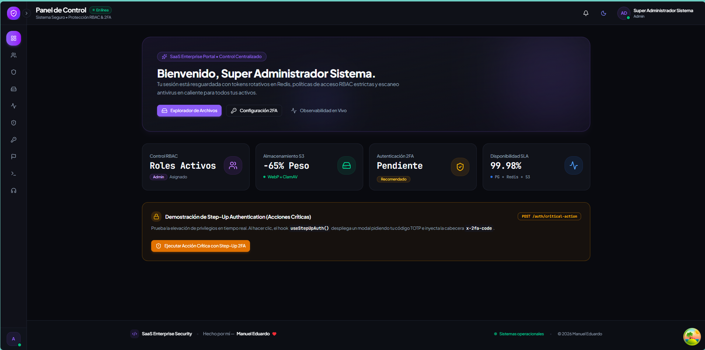
  <p><em>Panel de Control Principal en Modo Oscuro (Métricas, Estado del Sistema y Step-Up Authentication)</em></p>
</div>

<div align="center">
  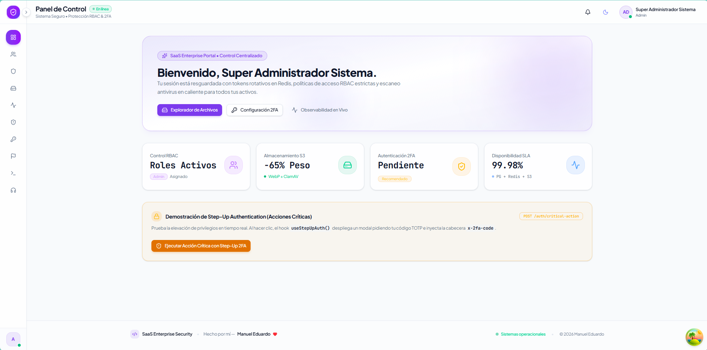
  <p><em>Panel de Control Principal en Modo Claro con sincronización semántica de tokens</em></p>
</div>

---

## 📑 Tabla de Contenidos

- [Módulos y Galería Visual](#-módulos-y-galería-visual)
  - [1. Autenticación y Registro Institucional](#1-autenticación-y-registro-institucional)
  - [2. Doble Factor de Autenticación (2FA / TOTP)](#2-doble-factor-de-autenticación-2fa--totp)
  - [3. Directorio de Usuarios y Operaciones CRUD](#3-directorio-de-usuarios-y-operaciones-crud)
  - [4. Control Jerárquico RBAC y Matriz de Permisos](#4-control-jerárquico-rbac-y-matriz-de-permisos)
  - [5. Almacenamiento S3 / SeaweedFS con Antivirus](#5-almacenamiento-s3--seaweedfs-con-antivirus)
  - [6. Auditoría y Visor de Diferencias JSON](#6-auditoría-y-visor-de-diferencias-json)
  - [7. Observabilidad, Salud y Telemetría en Vivo](#7-observabilidad-salud-y-telemetría-en-vivo)
  - [8. Gestión de Feature Flags en Tiempo Real](#8-gestión-de-feature-flags-en-tiempo-real)
  - [9. Logs y Diagnóstico Unificado del Sistema](#9-logs-y-diagnóstico-unificado-del-sistema)
  - [10. Bot de Discord: Orquestación de Música y Mensajería](#10-bot-de-discord-orquestación-de-música-y-mensajería)
- [Stack Tecnológico](#-stack-tecnológico)
- [Estructura del Proyecto](#-estructura-del-proyecto)
- [Requisitos Previos](#-requisitos-previos)
- [Instalación y Entorno Local](#-instalación-y-entorno-local)
- [Variables de Entorno](#-variables-de-entorno)
- [Scripts Disponibles](#-scripts-disponibles)
- [Despliegue con Docker y Nginx](#-despliegue-con-docker-y-nginx)
- [Seguridad y Jerarquía RBAC](#-seguridad-y-jerarquía-rbac)
- [Licencia](#-licencia)

---

## 🌟 Módulos y Galería Visual

### 1. Autenticación y Registro Institucional
Protección perimetral mediante JWT rotativo, tokens de sesión seguros, medidor reactivo de entropía de contraseñas y soporte para federación Google OAuth.

| Inicio de Sesión | Registro Institucional |
| :---: | :---: |
| 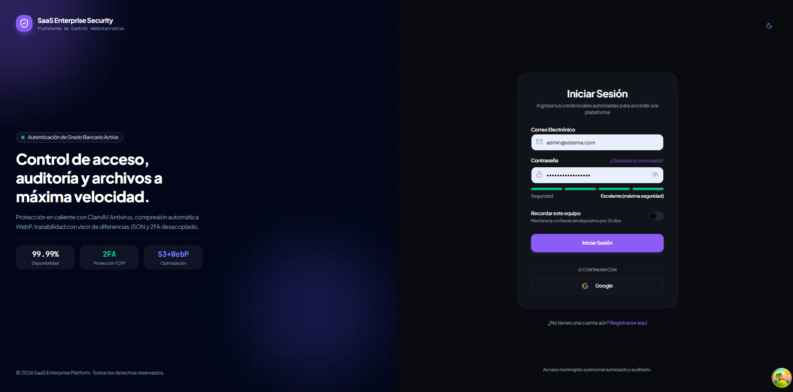 | 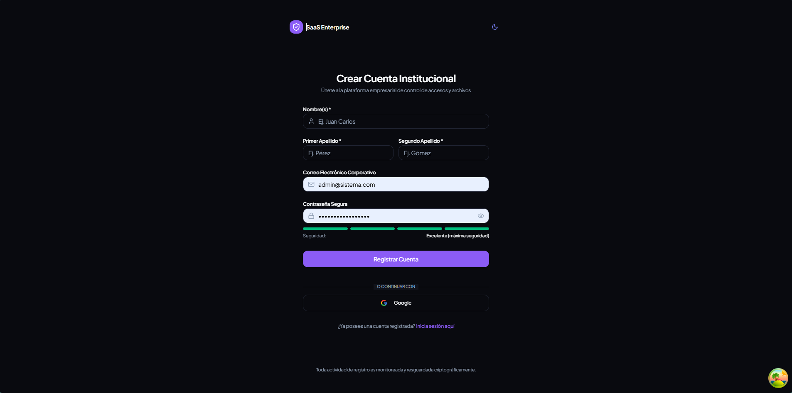 |
| *Validación estricta, medidor de seguridad y sesión persistente.* | *Alta de cuenta corporativa con protección criptográfica.* |

---

### 2. Doble Factor de Autenticación (2FA / TOTP)
Enrolamiento con código QR estandarizado compatible con Google Authenticator, 1Password y Authy, provisión de clave secreta manual e inputs segmentados con validación en caliente.

<div align="center">
  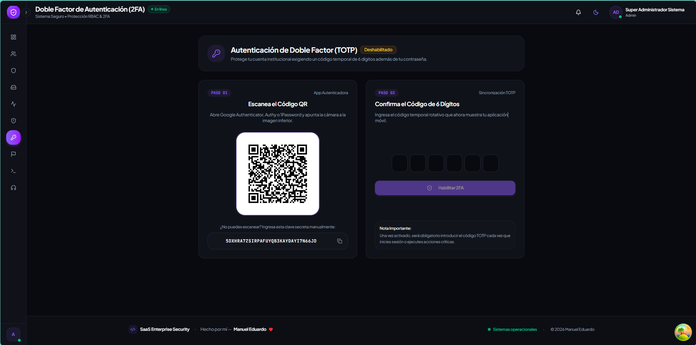
  <p><em>Enrolamiento de Doble Factor con QR dinámico y slots OTP interactivos</em></p>
</div>

---

### 3. Directorio de Usuarios y Operaciones CRUD
Tabla de alto rendimiento construida con **TanStack Table v8** y virtualización con **TanStack Virtual v3** para renderizado a 60 FPS de grandes volúmenes de datos. Incluye búsqueda en vivo, filtros combinados por rol y estado, exportación a CSV/JSON y mutaciones optimistas.

#### Directorio Principal
<div align="center">
  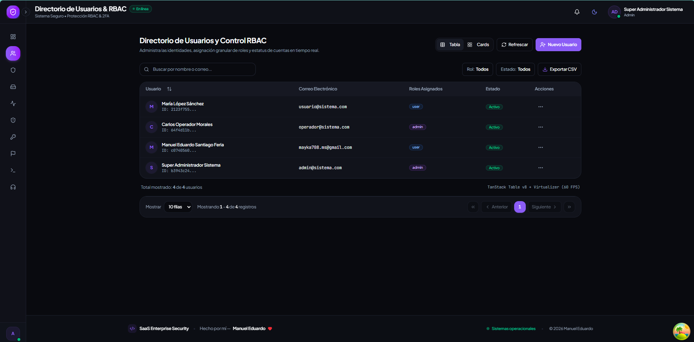
  <p><em>Directorio reactivo con paginación, filtros rápidos, búsqueda y exportación CSV</em></p>
</div>

#### Ficha de Usuario, Edición y Acciones Críticas
| Detalle de Usuario y Permisos | Edición de Cuenta y Perfil | Baja Lógica (Soft Delete) |
| :---: | :---: | :---: |
| 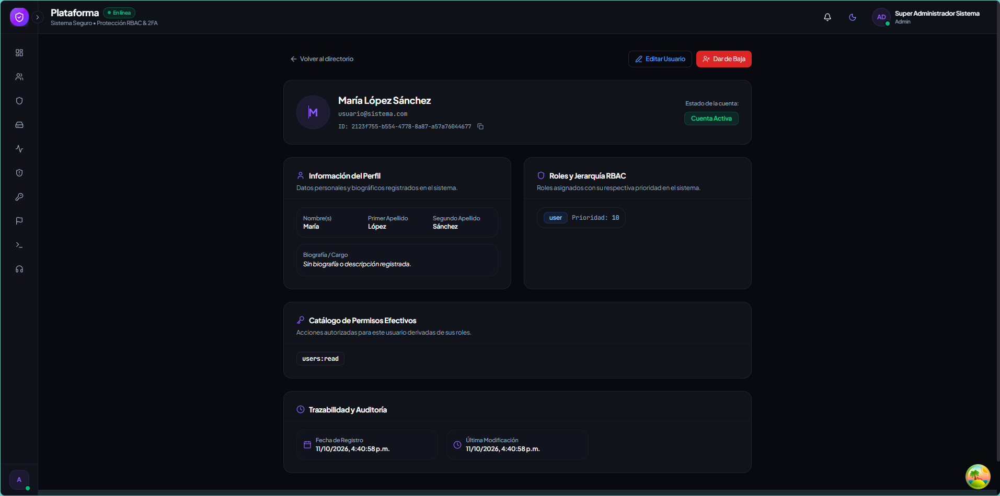 | 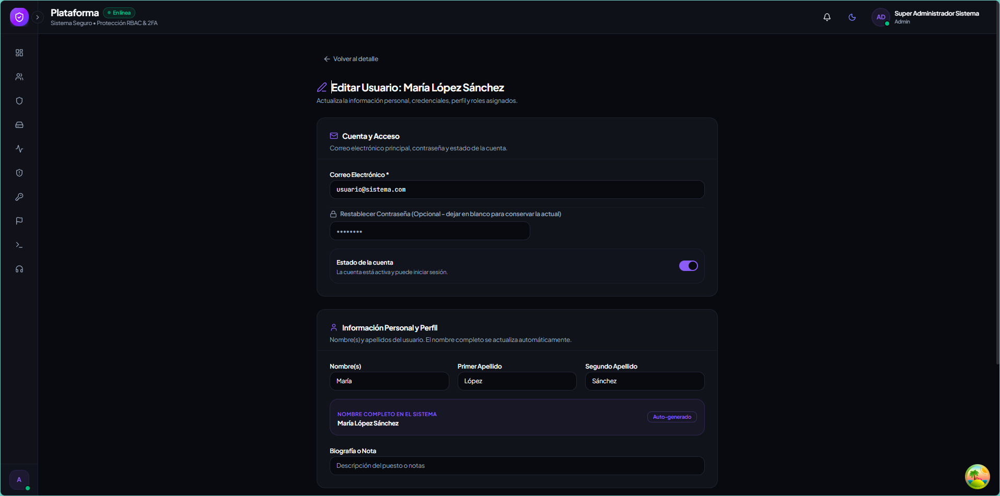 | 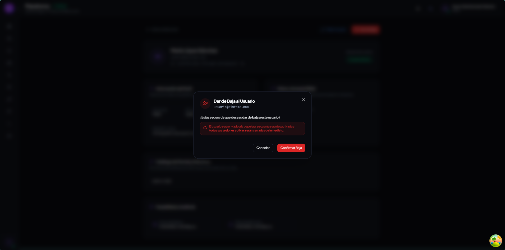 |
| *Inspección de roles, prioridad y permisos efectivos.* | *Actualización de credenciales, nombres y bio.* | *Modal de confirmación segura con revocación de sesiones.* |

---

### 4. Control Jerárquico RBAC y Matriz de Permisos
Sistema de autorización con defensas contra **escalada de privilegios**: ningún usuario puede crear ni asignar un rol de prioridad mayor o igual a la suya ($\text{prioridad} < \text{prioridad\_creador}$).

| Edición de Rol Base (`superadmin`) | Creación de Rol Subordinado |
| :---: | :---: |
| 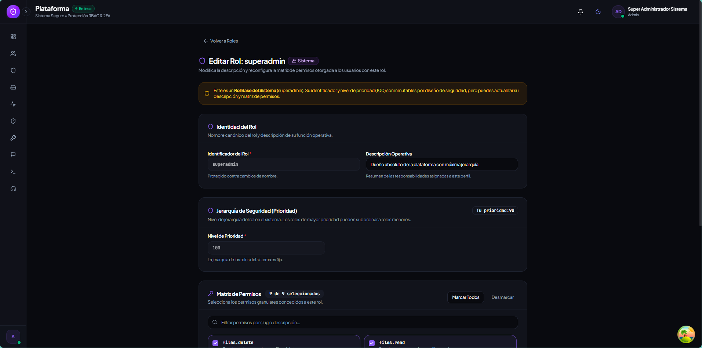 | 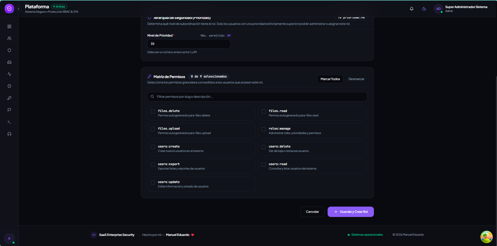 |
| *Roles base del sistema con jerarquía protegida (prioridad fija = 100).* | *Restricción automática de prioridad (Máx. permitido: 89) y matriz modular.* |

---

### 5. Almacenamiento S3 / SeaweedFS con Antivirus
Pipeline de carga en caliente con compresión automática a formato **WebP (-65% peso)**, escaneo antivirus paralelo con **ClamAV Daemon**, y visor interactivo seguro en modal (*Lightbox*) con prevención de bloqueos CORP.

#### Dropzone y Galería de Archivos
<div align="center">
  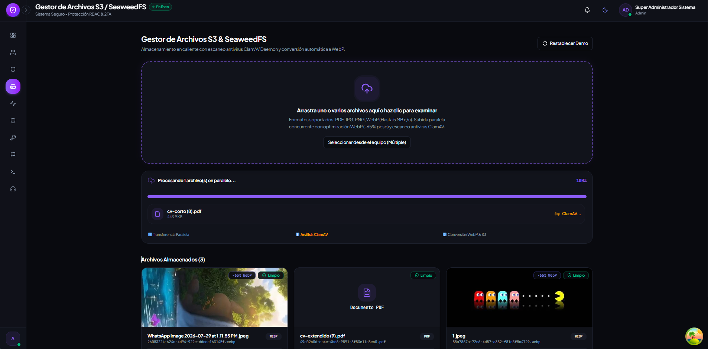
  <p><em>Carga múltiple con transferencia paralela, análisis ClamAV y conversión a WebP</em></p>
</div>

#### Visor Ampliado y Eliminación Segura
| Visor Lightbox en Modal | Confirmación de Borrado |
| :---: | :---: |
| 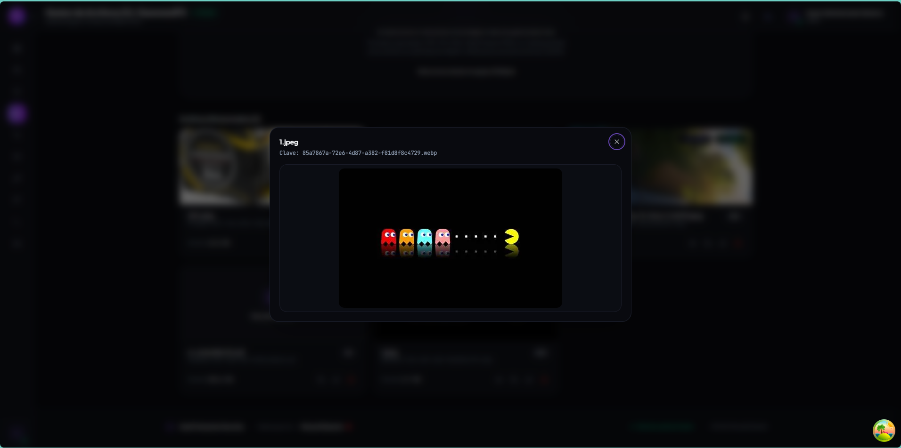 | 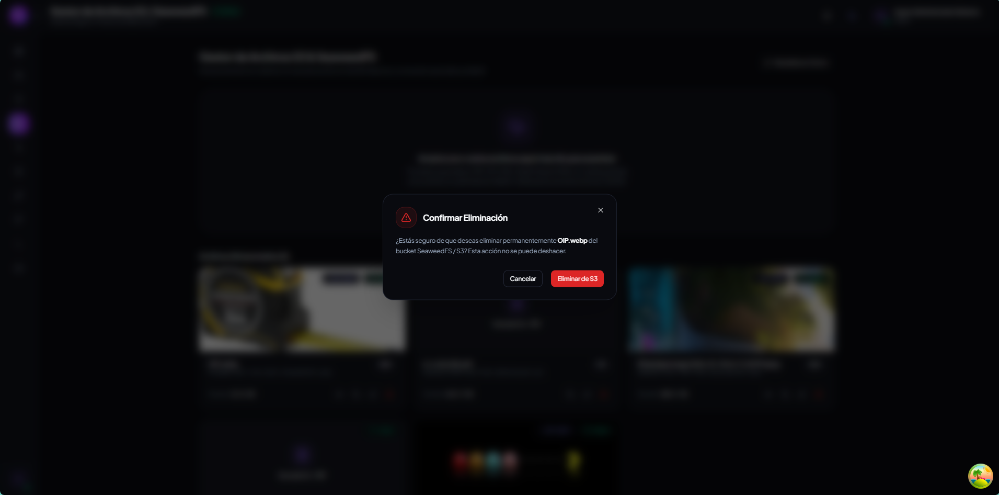 |
| *Visualización ampliada de alta fidelidad con streaming seguro.* | *Confirmación con advertencia de impacto destructivo.* |

---

### 6. Auditoría y Visor de Diferencias JSON
Registro inmutable de todas las mutaciones realizadas en la plataforma (LOGIN, UPDATE_USER, UPLOAD_FILE, DELETE_FILE) con visor de diferencias (*Diff Viewer*) en formato JSON (*Before* vs *After*).

| Bitácora de Auditoría | Visor de Diferencias (Side-by-Side Diff) |
| :---: | :---: |
| 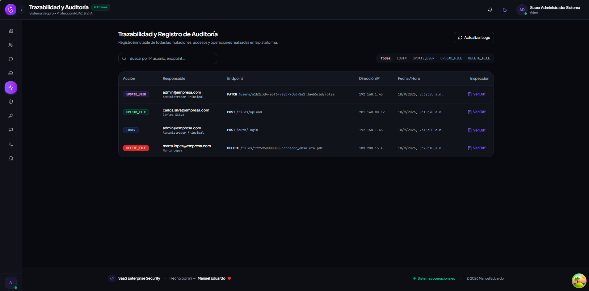 | 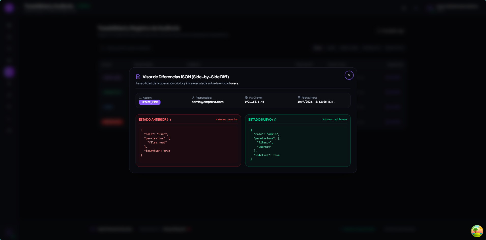 |
| *Trazabilidad por responsable, endpoint e IP cliente.* | *Comparador visual en tiempo real de cambios de estado.* |

---

### 7. Observabilidad, Salud y Telemetría en Vivo
Panel de monitoreo integral conectado a NestJS Terminus, PostgreSQL, réplicas de lectura, Redis y SeaweedFS S3 con refresco automático configurable.

#### Estado de Infraestructura y Servicios Críticos
<div align="center">
  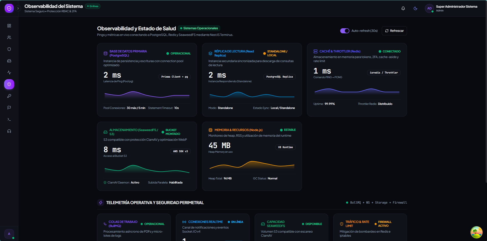
  <p><em>Monitoreo de latencia en PostgreSQL, Réplica de lectura, Redis Throttler, S3 y Memoria Node.js</em></p>
</div>

#### Telemetría Operativa y Seguridad Perimetral
<div align="center">
  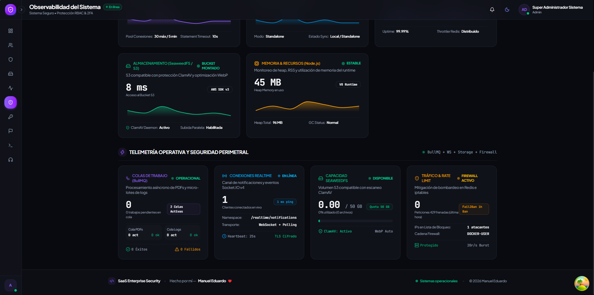
  <p><em>Colas asíncronas BullMQ, conexiones WebSocket activas, cuota S3 y mitigación Fail2Ban</em></p>
</div>

---

### 8. Gestión de Feature Flags en Tiempo Real
Permite encender o apagar capacidades de la plataforma al instante (OAuth Google/Facebook, S3 Multipart, Modo Oscuro v2) respaldadas por **Redis Cache** y persistencia en **PostgreSQL** sin reiniciar servicios.

<div align="center">
  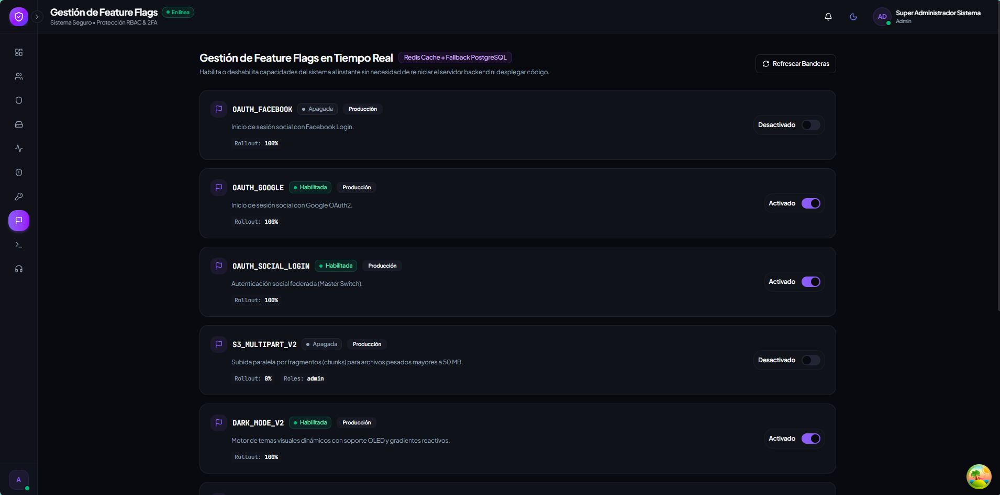
  <p><em>Control en vivo de rollouts progresivos y restricciones por roles</em></p>
</div>

---

### 9. Logs y Diagnóstico Unificado del Sistema
Consola de diagnóstico centralizada con estadísticas de las últimas 24 horas, distinción de fuentes (Backend vs Frontend) y filtrado de eventos por severidad (ERROR, WARN, INFO).

<div align="center">
  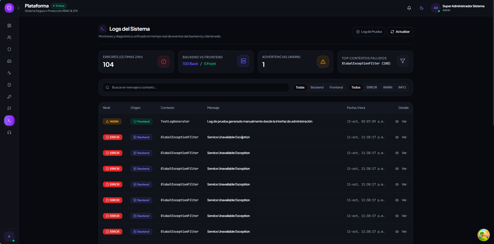
  <p><em>Monitoreo en vivo de excepciones y advertencias de la plataforma</em></p>
</div>

---

### 10. Bot de Discord: Orquestación de Música y Mensajería
Módulo interactivo para el control y reproducción de audio en canales de voz de Discord mediante **Lavalink v4** (decodificación PCM 48kHz), sincronización de colas en tiempo real y despacho de anuncios institucionales a canales de texto.

#### Reproductor y Cola de Pistas
| Reproductor en Vivo con Lavalink v4 | Cola de Reproducción Dinámica |
| :---: | :---: |
| 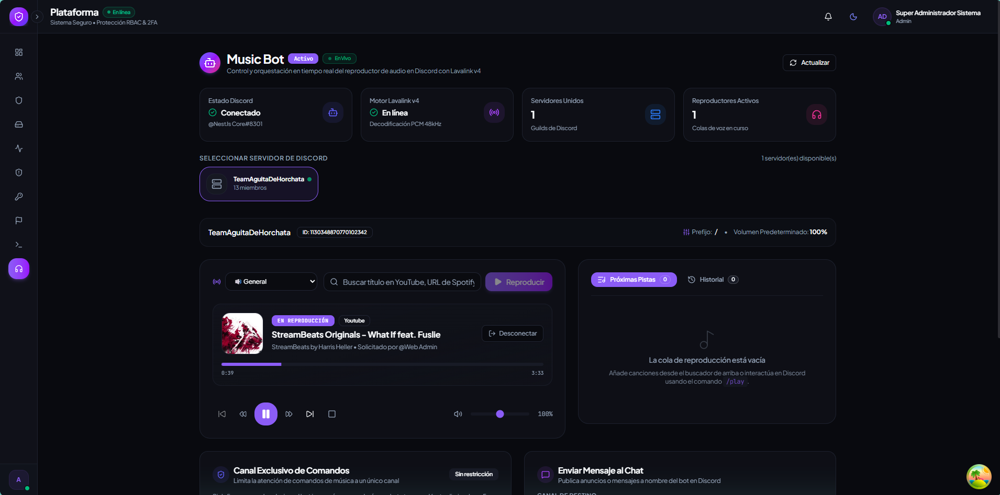 | 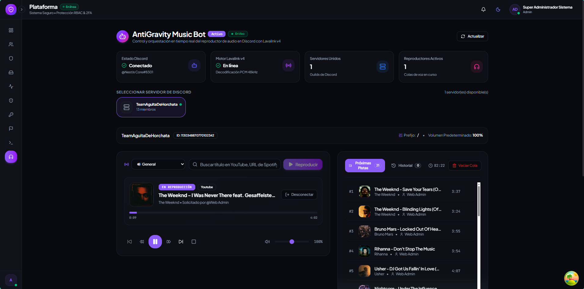 |
| *Controles interactivos de reproducción, volumen y estado del bot.* | *Gestión de lista de espera con duración total e historial.* |

#### Mensajería y Canales de Texto
| Despacho de Mensaje desde la Plataforma | Recepción Instantánea en Discord |
| :---: | :---: |
| 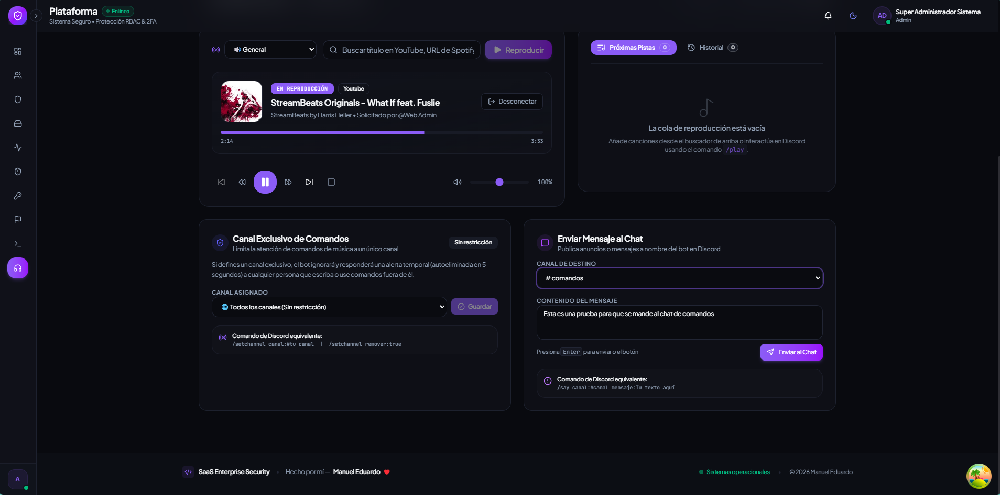 | 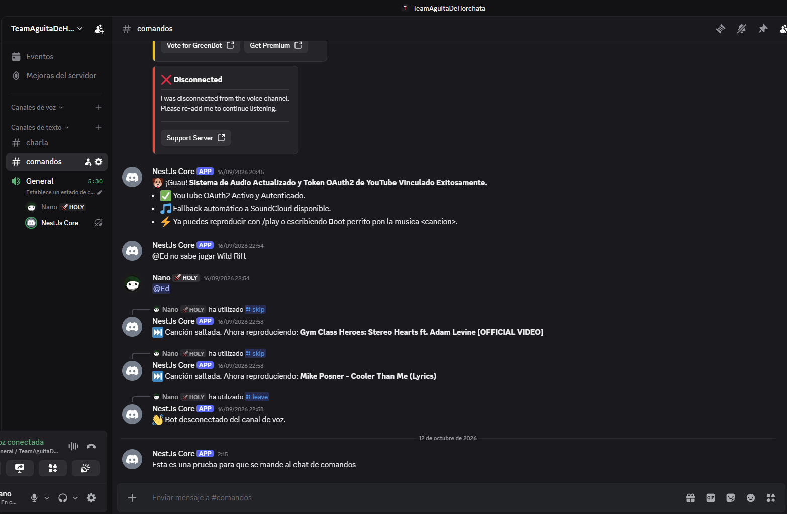 |
| *Selector de canal de destino y redactor de anuncios.* | *Confirmación de entrega en tiempo real en el servidor.* |

#### Restricción de Comandos
<div align="center">
  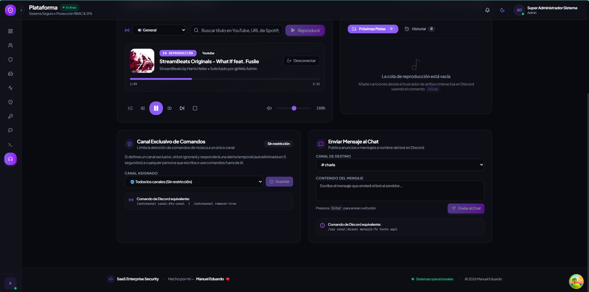
  <p><em>Configuración de canal exclusivo para evitar spam en otros canales del servidor</em></p>
</div>

---

## 🛠️ Stack Tecnológico

| Capa | Tecnologías |
| :--- | :--- |
| **Núcleo** | React 19, TypeScript 6, Vite 8 |
| **Estilos y UI** | Tailwind CSS v4, Radix UI Primitives, Lucide React, Framer Motion |
| **Gestión de Estado** | Zustand v5, TanStack Query v5 (React Query) |
| **Tablas y Listas** | TanStack Table v8, TanStack Virtual v3 |
| **Formularios y Validación** | React Hook Form, Zod v4, @hookform/resolvers |
| **Gráficos y Métricas** | Recharts v3 |
| **Notificaciones y Toasts** | Sonner v2 (con diseño semántico y soporte Dark/Light Mode) |
| **Red y WebSockets** | Axios v1, Socket.io Client v4 |
| **Seguridad de Cliente** | DOMPurify, Input OTP |
| **Infraestructura & Contenedor** | Docker, Docker Compose, Nginx 1.27 Alpine |

---

## 📁 Estructura del Proyecto

El proyecto sigue una arquitectura orientada a características (**Feature-Driven / Screaming Architecture**):

```text
Sistema_Front/
├── .env.example                # Plantilla de variables de entorno
├── docker-compose.yml          # Orquestación de contenedores para producción
├── Dockerfile                  # Dockerfile multi-etapa (Node 22 builder + Nginx Alpine runner)
├── nginx.conf                  # Configuración optimizada de Nginx (SPA, Gzip, Seguridad)
├── package.json                # Manifiesto de dependencias y scripts
├── pnpm-lock.yaml              # Lockfile determinista de pnpm
├── docs/
│   └── screenshots/            # Capturas de pantalla oficiales de la plataforma
├── src/
│   ├── api/                    # Cliente Axios centralizado, endpoints y gestión de sesión
│   ├── components/
│   │   ├── layout/             # Layout principal, Navbar, Sidebar, Breadcrumbs
│   │   ├── shared/             # Componentes transversales (PageHeader, EmptyState, ConfirmDialog, etc.)
│   │   └── ui/                 # Componentes base basados en Radix UI y Tailwind CSS
│   ├── features/               # Módulos funcionales del sistema
│   │   ├── audit/              # Logs de auditoría y visor de diferencias
│   │   ├── auth/               # Inicio de sesión, registro, verificación de email
│   │   ├── dashboard/          # Métricas y KPIs de inicio
│   │   ├── discord-bot/        # Panel de control e integración de Discord Bot
│   │   ├── documents/          # Previsualización y generación de reportes PDF
│   │   ├── feature-flags/      # Gestión de banderas de funcionalidad
│   │   ├── files/              # Gestión de archivos en S3 y galería multimedia
│   │   ├── health/             # Telemetría y monitoreo de servicios
│   │   ├── notifications/      # Manejo de alertas y conexión Socket.io
│   │   ├── roles/              # Creación y administración jerárquica de roles (RBAC)
│   │   ├── system-logs/        # Consola de logs en vivo del sistema
│   │   ├── two-factor/         # Configuración y autenticación TOTP (2FA)
│   │   └── users/              # Directorio de usuarios, perfiles y asignación de roles
│   ├── hooks/                  # Custom hooks globales (useTheme, useMediaQuery, etc.)
│   ├── lib/                    # Utilidades de bajo nivel (cn, tailwind-merge)
│   ├── router/                 # Configuración de React Router y Route Guards
│   ├── stores/                 # Tiendas globales Zustand (useAuthStore, useUIStore)
│   ├── types/                  # Definiciones de tipos globales
│   └── utils/                  # Helpers (manejo de JWT, fechas, formateadores)
└── vite.config.ts              # Configuración de compilación con Vite y Tailwind v4
```

---

## 🚀 Requisitos Previos

- **Node.js**: `v20.x` o `v22.x LTS` (recomendado v22)
- **Gestor de Paquetes**: `pnpm` (v10 o superior)
- **Docker & Docker Compose**: (Opcional, necesario para despliegues contenerizados)

---

## 💻 Instalación y Entorno Local

1. **Clonar el repositorio:**
   ```bash
   git clone <URL_DEL_REPOSITORIO>
   cd Sistema_Front
   ```

2. **Instalar dependencias con pnpm:**
   ```bash
   pnpm install
   ```

3. **Configurar el archivo de entorno:**
   Copia el archivo de plantilla `.env.example` como `.env`:
   ```bash
   cp .env.example .env
   ```

4. **Iniciar el servidor de desarrollo:**
   ```bash
   pnpm run dev
   ```
   La aplicación estará disponible de forma predeterminada en [http://localhost:5173](http://localhost:5173).

---

## ⚙️ Variables de Entorno

Configura las siguientes variables en tu archivo `.env`:

| Variable | Descripción | Valor por Defecto |
| :--- | :--- | :--- |
| `VITE_API_URL` | URL base del API Backend NestJS | `http://localhost:3000/api` |
| `VITE_APP_NAME` | Nombre institucional visualizado en la aplicación | `SaaS Enterprise Security` |
| `VITE_ENABLE_MOCK_FALLBACK` | Permite usar datos de prueba si la API no está disponible | `true` |
| `VITE_FEATURE_DISCORD_BOT` | Habilita el módulo de integración con Discord | `false` |
| `FRONTEND_PORT` | Puerto expuesto en el host para el contenedor Docker | `80` |

> [!NOTE]
> En Vite, todas las variables de entorno con prefijo `VITE_` se incrustan en el bundle en **tiempo de compilación**. Para producción, estas se transmiten mediante argumentos de construcción (`build args`).

---

## 📜 Scripts Disponibles

En la raíz del proyecto puedes ejecutar:

| Comando | Acción |
| :--- | :--- |
| `pnpm run dev` | Inicia el servidor de desarrollo local con Vite y HMR ultra-rápido. |
| `pnpm run build` | Ejecuta la verificación estricta de TypeScript (`tsc -b`) y compila para producción. |
| `pnpm run type-check` | Realiza el chequeo de tipos TypeScript sin emitir archivos (`tsc --noEmit`). |
| `pnpm run lint` | Ejecuta ESLint para auditar la calidad del código y buenas prácticas. |
| `pnpm run preview` | Levanta un servidor local para previsualizar el bundle generado en `/dist`. |

---

## 🐳 Despliegue con Docker y Nginx

El proyecto incluye un entorno contenerizado listo para producción con **Dockerfile multi-etapa** y servidor web **Nginx Alpine** de alto rendimiento (~25MB).

### Características del Contenedor de Producción:
- **Compilación Multi-Etapa**: Etapa de build con Node.js 22 y Corepack/pnpm, y etapa final ultra-ligera con Nginx Alpine.
- **Soporte SPA Nativo**: Redirección automática de rutas mediante `try_files $uri $uri/ /index.html;`.
- **Estrategia de Caché Agresiva**:
  - Assets con hash único (`/assets/*`): `Cache-Control: public, max-age=31536000, immutable`.
  - Archivo `index.html`: `Cache-Control: no-store, no-cache, must-revalidate` para despliegues instantáneos.
- **Compresión Gzip Activa**: Para archivos JS, CSS, JSON, SVG y HTML.
- **Cabeceras de Seguridad HTTP**: `X-Frame-Options`, `X-Content-Type-Options`, `X-XSS-Protection`, `Referrer-Policy` y `Permissions-Policy`.
- **Healthcheck Automático**: Monitoreo continuo mediante el endpoint `/healthz`.

### Comandos Docker:

```bash
# 1. Construir la imagen con las variables de compilación:
docker compose build

# 2. Iniciar el contenedor en segundo plano:
docker compose up -d

# 3. Consultar logs del contenedor:
docker compose logs -f frontend

# 4. Detener el servicio:
docker compose down
```

---

## 🔒 Seguridad y Jerarquía RBAC

El sistema implementa defensas a nivel de diseño arquitectónico:

1. **Jerarquía Antiescalada de Privilegios**:
   - Ningún usuario administrador puede crear ni asignar un rol que posea una prioridad superior o igual a la suya.
   - La regla estricta aplicada es: $\text{prioridad\_nuevo\_rol} < \text{prioridad\_usuario\_actual}$.
2. **Unicidad e Inmutabilidad de Roles del Sistema**:
   - Los nombres de roles se normalizan a formato *slug* y no se permite duplicar nombres ni niveles de prioridad existentes.
   - Roles base del sistema (`superadmin`, `admin`, `user`) quedan protegidos contra eliminación destructiva.
3. **Sanitización de Datos**:
   - Uso de **DOMPurify** en renderizado de contenidos HTML/SVG para prevenir vectores XSS.
   - Esquemas de validación con **Zod** en todos los formularios antes de emitir solicitudes a la API.

---

## 📄 Licencia

Este proyecto está bajo una **Licencia Comercial Propietaria**. Consulta el archivo [`LICENSE.md`](./LICENSE.md) para más detalles sobre los términos de uso y derechos reservados.

Copyright (c) 2026 Manuel Eduardo Santiago Feria. Todos los derechos reservados.
